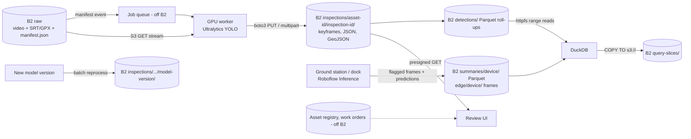

# Detect and geolocate defects in inspection imagery and video

## Workload

Inspection drones fly towers, power lines, solar farms, wind blades, bridges and roofs. Detection models scan the video and stills, and each detection is geotagged from the flight's GPS track. One inspection video fans out into hundreds of derived objects, across thousands of assets per season. Operators need results tied to source media and location, queryable across the fleet, and reprocessable in batch when a better model ships.

## Data flow



1. Source video and SRT/GPX telemetry land in `raw/` (see [flight-capture-offload](../flight-capture-offload/architecture.md)). The manifest event enqueues an inference job.
2. The worker streams the video from B2, samples keyframes, runs Ultralytics YOLO on a local GPU, and extracts the GPS track from sidecar telemetry.
3. It writes annotated keyframes, per-frame detection JSON, `summary.json` and a GeoJSON track to `inspections/<asset-id>/<inspection-id>/<model-version>/`. The review UI reads them by presigned GET.
4. Edge variant (B2-side pattern): Roboflow Inference runs on the ground station or dock computer. It archives only flagged frames and prediction JSON, with hourly Parquet roll-ups under `summaries/<device>/`. The Roboflow sample is built around cameras; the same pattern fits a dock computer.
5. A roll-up job appends detection rows to Parquet under `detections/`. DuckDB httpfs, with an S3 secret whose `ENDPOINT` is the B2 endpoint, queries the Parquet fleet-wide and writes slices back to `query-slices/` with `COPY ... TO 's3://...'`.
6. When a better model ships, a batch job (see the YOLO11 Batch Detection Pipeline sample) reprocesses the archive under a new model-version prefix. Earlier results are never overwritten.

## B2 zones

| Bucket | Prefix | Versioning / lifecycle | Object Lock | Purpose |
|---|---|---|---|---|
| `<org>-drone-raw` | `raw/<client>/<site>/<mission-id>/` | As in flight-capture-offload | As in flight-capture-offload | Source video and telemetry |
| `<org>-drone-products` | `inspections/<asset-id>/<inspection-id>/<model-version>/` | Immutable per model version | Governance or legal hold for evidentiary inspections | Keyframes, JSON, GeoJSON, summary |
| `<org>-drone-products` | `edge/<device>/`, `summaries/<device>/` | Hide unflagged or aged edge frames after N days, then delete | None | Edge-archived frames and Parquet roll-ups |
| `<org>-drone-products` | `detections/` | Append new partitions; compaction job replaces old files | None | Fleet-wide Parquet |
| `<org>-drone-products` | `query-slices/` | Expire after N days | None | DuckDB result slices (throwaway) |

Lifecycle cannot delete files under active Object Lock retention or legal hold.

## Boundaries

| Stays off B2 | Where | Why |
|---|---|---|
| Asset registry, work orders, defect review status | Database | Transactional, edited by people |
| Inference job queue | Queue service | Acknowledgements and retries |
| Model weights at inference time | Local GPU disk cache | Loaded per job; canonical weights live in `models/` (see [inspection-training-data](../inspection-training-data/architecture.md)) |
| Frame decoding and keyframe scratch | Local disk | Temporary |

## B2 capability map

| Capability | Used | Notes |
|---|---|---|
| S3 API, regional endpoint | Yes | boto3 `endpoint_url` derived from `B2_REGION` |
| Multipart upload | Yes | Multi-GB inspection video |
| Presigned GET | Yes | Review UI media |
| Event Notifications | Yes | Manifest event enqueues inference |
| HTTP range reads | Yes | DuckDB reads Parquet footers and row groups |
| Object Lock / legal hold | Yes | Evidentiary inspection records |
| Scoped keys | Yes | Write-only per edge device; read-only for analysts |
| CORS | Optional | Only if the review UI reads presigned URLs from the browser |
| CDN, Cloud Replication, Overdrive | Not used | Review traffic is internal and modest |

## Integration configuration

### boto3 in Ultralytics and Roboflow pipelines

- Set `endpoint_url=f"https://s3.{B2_REGION}.backblazeb2.com"`, with an optional `B2_ENDPOINT` override. This matches the [YOLO Drone Footage Detection](https://github.com/backblaze-b2-samples/yolo-drone-footage-detection) sample.
- Stream video with managed multipart, and serve review media by presigned GET with a short TTL.
- Workers use a key restricted to `inspections/` with `listFiles,readFiles,writeFiles`. They read `raw/` with a separate read-only key, because one key covers one prefix.
- Each edge device gets a write-only key restricted to `edge/<device>/` (and a second for `summaries/<device>/`), or presigned PUTs from a site service.

### DuckDB httpfs

```sql
-- Values are templated from configuration; never commit them. <region> comes from the bucket.
CREATE SECRET b2 (
  TYPE s3,
  KEY_ID '<B2_APPLICATION_KEY_ID>',
  SECRET '<B2_APPLICATION_KEY>',
  REGION '<region>',
  ENDPOINT 's3.<region>.backblazeb2.com'
);
SELECT asset_id, class, count(*) FROM read_parquet('s3://<bucket>/detections/**/*.parquet') GROUP BY ALL;
```

DuckDB documents `ENDPOINT` for custom S3 endpoints ([httpfs S3 API](https://duckdb.org/docs/current/core_extensions/httpfs/s3api.html)). The [DuckDB Query In Place](https://github.com/backblaze-b2-samples/duckdb-query-in-place) sample corroborates it against B2. Keep the secret in memory (the default `CREATE SECRET`) rather than `CREATE PERSISTENT SECRET`, which writes it to disk.

## Security

- Edge devices hold only write-only, prefix-scoped keys, or presigned PUTs.
- Analysts get read-only keys on `detections/` and `summaries/`. Only the slice writer can write `query-slices/`. A B2 key carries one prefix, so analysts hold one read key per prefix.
- Reprocessing writes a new model-version prefix and never overwrites earlier results.
- Use governance-mode Object Lock or legal hold for inspections that support regulatory or insurance claims. Choose compliance mode only when a contract or regulation requires it.

## References

- [Ultralytics](https://github.com/ultralytics/ultralytics)
- [Roboflow Inference](https://github.com/roboflow/inference)
- [DuckDB httpfs S3 API](https://duckdb.org/docs/current/core_extensions/httpfs/s3api.html)
- [B2 Object Lock](https://www.backblaze.com/docs/cloud-storage-object-lock)
- [B2 Event Notifications](https://www.backblaze.com/docs/cloud-storage-event-notifications)
- Samples: [YOLO Drone Footage Detection](https://github.com/backblaze-b2-samples/yolo-drone-footage-detection), [Roboflow Inference Frame Archive](https://github.com/backblaze-b2-samples/roboflow-inference-frame-archive), [YOLO11 Batch Detection Pipeline](https://github.com/backblaze-b2-samples/yolo11-batch-detection-pipeline), [DuckDB Query In Place](https://github.com/backblaze-b2-samples/duckdb-query-in-place), [B2 Event Broker](https://github.com/backblaze-b2-samples/b2-event-broker)
