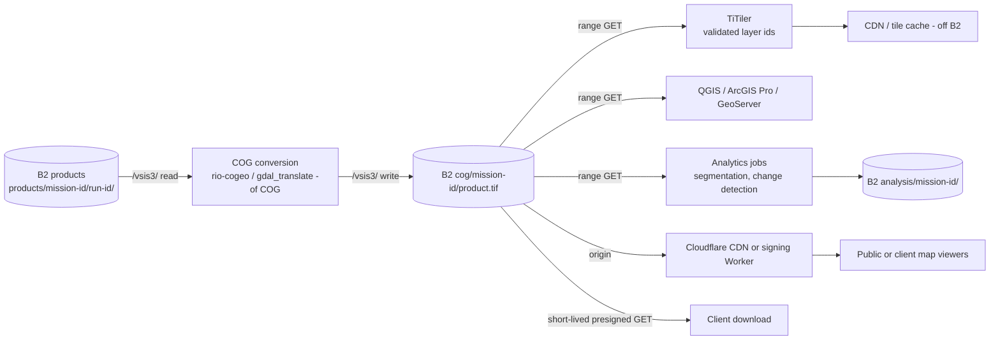

# Serve orthomosaics and elevation models as cloud-optimized map layers

## Workload

Clients and analysts view and analyze multi-GB orthomosaics, DEMs and multispectral index maps such as NDVI without downloading them. Each product is stored once as a Cloud-Optimized GeoTIFF (COG) with internal overviews. Tile servers, desktop GIS and Python read only the byte ranges they need. No XYZ tile pyramid is pre-rendered or stored.

## Data flow



1. A conversion job reads `products/<mission-id>/<run-id>/orthophoto.tif`. It writes a COG to `cog/<mission-id>/<product>.tif` through GDAL `/vsis3/`, with `AWS_S3_ENDPOINT` pointed at B2, using `rio cogeo create` or `gdal_translate -of COG`.
2. TiTiler renders XYZ/WMTS tiles on demand from range GETs. It accepts only validated layer ids that map to keys, never raw URLs.
3. Desktop and server GIS open the same objects in place: QGIS through `/vsis3/`, ArcGIS Pro through a cloud storage connection file, and GeoServer through the COG community module.
4. Optional analytics jobs read windows and write masks and GeoJSON to `analysis/<mission-id>/`. Examples are SAM-based segmentation and change detection between repeat survey flights.
5. Public basemaps go through Cloudflare with B2 as origin. Private deliverables go out as short-lived presigned GETs, or through a Worker that signs requests to a private bucket.

## B2 zones

| Bucket | Prefix | Versioning / lifecycle | Object Lock | Purpose |
|---|---|---|---|---|
| `<org>-drone-products` | `cog/<mission-id>/` | Overwrite only by publishing a new mission or run; expire superseded layers by job | Optional for contracted deliverables | One COG per product |
| `<org>-drone-products` | `analysis/<mission-id>/` | Kept with the mission; no age expiry | None | Masks, GeoJSON, change maps (deliverables) |
| `<org>-drone-public` (optional) | `basemaps/<layer-id>/` | Keep current only | None | Cleared imagery served publicly through the CDN |

Keep public and private data in separate buckets. Bucket visibility is set per bucket, not per prefix.

## Boundaries

| Stays off B2 | Where | Why |
|---|---|---|
| Rendered tile cache | CDN or Redis | Hot, short-lived, regenerable |
| Layer registry, render configs, styles | Database or config store | Small, transactional |
| Map server configuration and user auth | Map server, identity provider | Not object data |
| Pre-rendered XYZ pyramids | Not stored | Rendered on demand from COGs |

## B2 capability map

| Capability | Used | Notes |
|---|---|---|
| S3 API with HTTP range GETs | Yes | GDAL `/vsis3/` reads COG headers and tiles by range |
| Presigned GET URLs | Yes | Time-limited client delivery |
| CORS rules | Yes | Browser map clients reading presigned COG URLs |
| Scoped read-only keys | Yes | One per tile server, GIS group or Worker, restricted to `cog/` |
| CDN origin (Cloudflare) | Yes | See [B2 pricing](https://www.backblaze.com/cloud-storage/pricing) for egress terms through partner CDNs |
| Included egress | Yes | Downstream delivery is read-heavy; see [B2 pricing](https://www.backblaze.com/cloud-storage/pricing) |
| Multipart upload | Yes | GDAL and rio-cogeo writes of large COGs |
| Event Notifications | Optional | Trigger conversion when a run manifest lands |
| Object Lock, Cloud Replication | Not used | Products are covered upstream |
| Overdrive | Consider only if measured | Tile caches normally absorb repeated reads |

## Integration configuration

All endpoints are derived from the bucket region: `https://s3.<region>.backblazeb2.com`. Never hardcode one.

### GDAL `/vsis3/`

```bash
export AWS_S3_ENDPOINT="s3.${B2_REGION}.backblazeb2.com"   # host only, no scheme
export AWS_REGION="$B2_REGION"
export AWS_VIRTUAL_HOSTING=TRUE                            # B2 supports virtual-hosted-style requests
export AWS_ACCESS_KEY_ID="<application-key-id>" AWS_SECRET_ACCESS_KEY="<application-key>"
gdal_translate -of COG /vsis3/$BUCKET/products/$MISSION/$RUN/orthophoto.tif /vsis3/$BUCKET/cog/$MISSION/ortho.tif
```

Writing COGs directly to `/vsis3/` depends on the GDAL version and driver. Writing locally and uploading is the conservative path. See the [GDAL virtual file systems](https://gdal.org/en/stable/user/virtual_file_systems.html) documentation.

### Rasterio and rio-cogeo

Pass `rasterio.session.AWSSession(endpoint_url="s3.<region>.backblazeb2.com")` to `rasterio.Env`; it sets GDAL's `AWS_S3_ENDPOINT` ([source](https://github.com/rasterio/rasterio/blob/main/rasterio/session.py)). The environment variables above also work, and `rio cogeo create` writes COGs straight to `/vsis3/` paths.

### TiTiler

TiTiler reads COGs through GDAL, so set the `AWS_*` configuration above in the TiTiler container environment. The [TiTiler COG Map Tiles](https://github.com/backblaze-b2-samples/titiler-cog-map-tiles) sample derives the endpoint from `B2_REGION`. Give TiTiler a read-only key scoped to `cog/`, and map layer ids to keys server-side.

### QGIS

Add a raster layer with protocol type **AWS S3**, bucket `<bucket>` and object key `cog/<mission-id>/ortho.tif`, and set `AWS_S3_ENDPOINT=s3.<region>.backblazeb2.com` in the layer's credential options ([QGIS docs](https://docs.qgis.org/latest/en/docs/user_manual/managing_data_source/opening_data.html)). To share one configuration across layers, set the GDAL `AWS_*` variables globally under Settings → Options → Variables or in the environment. Give each GIS user group a read-only key scoped to `cog/`.

### Esri ArcGIS Pro

Run **Create Cloud Storage Connection File** with service provider Amazon, the bucket name, a read-only key scoped to `cog/`, and **Service End Point** `s3.<region>.backblazeb2.com`. Esri documents the custom endpoint for S3-compatible object storage ([Esri docs](https://doc.esri.com/en/arcgis-pro/latest/tool-reference/data-management/create-cloud-storage-connection-file.html)). Reference rasters through the resulting `.acs` file.

### GeoServer COG community module

Set `IIO_<SCHEME>_AWS_ENDPOINT` with `_AWS_USER`, `_AWS_PASSWORD` and `_AWS_REGION`, where `<SCHEME>` is the scheme of the layer URL. GeoServer keeps one S3 client per region and scheme alias.

```bash
# Layers addressed as s3://<bucket>/cog/<mission-id>/ortho.tif
IIO_S3_AWS_ENDPOINT="https://s3.${B2_REGION}.backblazeb2.com"
IIO_S3_AWS_REGION="$B2_REGION"
IIO_S3_AWS_USER="<application-key-id>" IIO_S3_AWS_PASSWORD="<application-key>"

# Layers addressed as https://s3.<region>.backblazeb2.com/<bucket>/cog/... use the HTTPS alias
IIO_HTTPS_AWS_ENDPOINT="https://s3.${B2_REGION}.backblazeb2.com"
IIO_HTTPS_AWS_REGION="$B2_REGION"
IIO_HTTPS_AWS_USER="<application-key-id>" IIO_HTTPS_AWS_PASSWORD="<application-key>"
```

GeoServer documents `IIO_<ALIAS>_AWS_ENDPOINT` for third-party S3-compatible services; set it to the full `https://` endpoint as above. Install the COG community module, which ships separately from GeoServer releases ([GeoServer docs](https://docs-archive.geoserver.org/stable/en/user/community/cog/cog.html)).

### Cloudflare CDN and Workers

- **Public bucket:** proxy a custom domain to the bucket's friendly URL. See the [Backblaze Cloudflare guides](https://www.backblaze.com/docs/cloud-storage-cloudflare-integrations).
- **Private bucket:** the [cloudflare-b2](https://github.com/backblaze-b2-samples/cloudflare-b2) Worker signs S3 requests with a read-only key scoped to `cog/` and passes `Range` headers through.

## Security

- Tile servers accept layer ids, never arbitrary URLs. Otherwise `/vsis3/` and `/vsicurl/` become a server-side request forgery path.
- Each consumer gets its own read-only key scoped to `cog/` or narrower. Analytics writers are scoped to `analysis/`.
- Treat presigned URLs as bearer credentials. Restrict CORS to exact map-viewer origins, with `GET` and `HEAD` only (see [`examples/cors-map-viewers.json`](../../examples/cors-map-viewers.json)).
- Publish only cleared imagery to the public bucket.

## References

- [GDAL virtual file systems](https://gdal.org/en/stable/user/virtual_file_systems.html)
- [rio-cogeo](https://github.com/cogeotiff/rio-cogeo)
- [TiTiler](https://github.com/developmentseed/titiler)
- [Backblaze Cloudflare integrations](https://www.backblaze.com/docs/cloud-storage-cloudflare-integrations)
- [B2 CORS rules](https://www.backblaze.com/docs/cloud-storage-cross-origin-resource-sharing-rules)
- [B2 pricing](https://www.backblaze.com/cloud-storage/pricing)
- Samples: [TiTiler COG Map Tiles](https://github.com/backblaze-b2-samples/titiler-cog-map-tiles), [cloudflare-b2](https://github.com/backblaze-b2-samples/cloudflare-b2)
