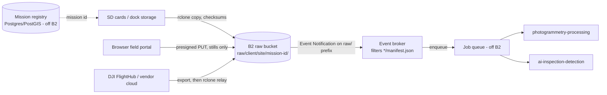
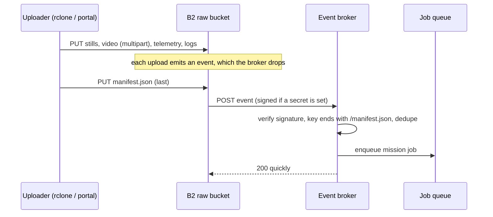

# Offload flight captures into a per-mission archive and trigger processing

## Workload

After each flight, a field laptop, ground station or relay moves captures off SD cards and docks: stills, video, SRT/GPX telemetry, flight logs and RTK/PPK correction files. Capture volume depends on image count, video bitrate and duration, and telemetry frequency. Captures must land once, intact and attributable, in one durable place. Their arrival must start processing reliably, without a file server in the middle.

B2 is the landing zone and system of record for raw captures. Mission ids, pilots, aircraft and work orders live in a database.

## Data flow

1. The field laptop runs `rclone copy` with the native B2 backend from the SD card or a staging folder into `raw/<client>/<site>/<mission-id>/`. `<client>` is the customer or business unit that owns the site. rclone verifies checksums and uploads large files in chunks.
2. A browser field portal can upload stills directly with presigned PUT URLs. The [B2 Browser Upload](https://github.com/backblaze-b2-samples/b2-browser-upload) sample shows this pattern. A single PUT is capped at 5 GB, so multi-GB video uses multipart upload from rclone or an SDK.
3. The uploader writes `manifest.json` last. It records the mission id, site, aircraft, camera, CRS, and a file list with client-computed hashes.
4. A B2 Event Notification rule on the `raw/` prefix posts to an event broker. Rules filter by prefix only, so the broker drops every event whose key does not end in `/manifest.json` and enqueues one job per mission. Without that filter, each of hundreds of image uploads would trigger a job.
5. DJI Dock and FlightHub fleets land media in the vendor cloud or a self-hosted store first. A relay running rclone then copies it to B2, because DJI's cloud storage options target AWS, Alibaba or a self-hosted store rather than B2 directly.

## B2 zones

| Bucket | Prefix | Versioning / lifecycle | Object Lock | Purpose |
|---|---|---|---|---|
| `<org>-drone-raw` | `raw/<client>/<site>/<mission-id>/` | Keep all versions; lifecycle cancels unfinished large-file uploads after N days | Enabled on the bucket; governance retention or legal hold for evidentiary missions | Write-once raw captures and `manifest.json` |
| `<org>-drone-raw` | `staging/<crew>/` (optional) | Hide, then delete after N days | None | Partial offloads awaiting a manifest |

Object Lock must be enabled on the bucket before retention can be set on files. Bucket names are globally unique, so prefix them with your organization and expect collisions. B2 has no storage tiers. Lifecycle rules here clean up unfinished uploads and staging objects; they never move captures.

## Boundaries

| Stays off B2 | Where | Why |
|---|---|---|
| Mission and flight registry, pilot and aircraft records, work orders | Postgres/PostGIS | Transactional, queried by location and time |
| Job queue and broker retry state | A queue service | Needs acknowledgements and retries, not objects |
| SD-card staging during copy | Field laptop disk | Local, temporary |
| Vendor-cloud credentials and export jobs | Relay tier | Use the vendor's export workflow, then upload completed files with scoped B2 application keys |
| Live remote viewing during flight | RTMP/WebRTC streaming | A streaming problem, not object storage |

This design uses application keys for relay uploads. For temporary role credentials, consult [Backblaze IAM and STS](https://www.backblaze.com/docs/cloud-storage-iam-sts-api) and confirm the required operations are available for the account.

## B2 capability map

| Capability | Used | Notes |
|---|---|---|
| S3-compatible API, regional endpoint | Yes | `https://s3.<region>.backblazeb2.com`, derived from the bucket region |
| Presigned PUT URLs and CORS | Yes | Portal uploads of stills; CORS limited to the portal origin ([`examples/cors-field-portal.json`](../../examples/cors-field-portal.json)) |
| Multipart upload | Yes | Required for objects over 5 GB; rclone and SDKs handle it |
| Scoped application keys | Yes | One write-and-list key per crew or relay (`writeFiles,listFiles`; rclone lists to skip existing files), bucket plus `raw/<client>/` prefix |
| Event Notifications | Yes | Prefix-filtered; enabled through Backblaze Support; optional signing secret |
| Lifecycle rules | Yes | `daysFromStartingToCancelingUnfinishedLargeFiles`; optional staging expiry ([`examples/lifecycle-raw.json`](../../examples/lifecycle-raw.json)) |
| Object Lock and legal hold | Yes | Evidentiary missions ([`examples/object-lock-evidence.json`](../../examples/object-lock-evidence.json)) |
| SSE-B2 | Optional | Default bucket encryption |
| Cloud Replication | Not used | Bucket-to-bucket DR only; add if policy requires a second region |
| CDN, Overdrive | Not used | Upload path is bound by the field uplink |

## Integration configuration

### rclone (native B2 backend)

- Configure a `b2` remote with an application key ID and key, or an `s3` remote with `provider = Other` and `endpoint = https://s3.<region>.backblazeb2.com`. Derive the region from the bucket; never copy one from an example.
- Use a key restricted to `<org>-drone-raw` and `raw/<client>/` with `listFiles,writeFiles` (add `readFiles` if `--checksum` comparisons need reads). Do not give field keys `deleteFiles`.
- Use `rclone copy`, not `rclone sync`, so a mistaken local deletion never propagates.
- Setup: the [Backblaze rclone guide](https://www.backblaze.com/docs/cloud-storage-integrate-rclone-with-backblaze-b2) and the [rclone B2 docs](https://rclone.org/b2/).

### boto3 (field portal and SDK uploads)

- `boto3.client("s3", endpoint_url=f"https://s3.{B2_REGION}.backblazeb2.com")` with keys held server-side. Browsers receive only presigned PUT URLs with a short TTL.
- Use `TransferConfig` managed multipart for video.
- The [OpenDroneMap sample](https://github.com/backblaze-b2-samples/opendronemap-photogrammetry-pipeline) demonstrates worker uploads through the B2 S3-compatible API.

### Event broker

- The [B2 Event Broker](https://github.com/backblaze-b2-samples/b2-event-broker) sample validates signed notifications and fans them out. Put the `*/manifest.json` filter there.
- Deliveries can repeat. Make the enqueue idempotent on `(bucket, key, version id)`.
- See [`examples/event-notifications-raw.json`](../../examples/event-notifications-raw.json).

## Security

- Field crews and relays hold prefix-scoped write-and-list keys without object reads or permanent version deletion. `writeFiles` still permits hiding objects or uploading new versions under existing keys. Strict append-only access needs a trusted upload relay that allocates fresh authorized keys and refuses replacements. Presigned PUTs limit the method and key but can be replayed until expiry. Object Lock protects retained versions but does not prevent hiding or a new current version.
- Bucket, lifecycle and Object Lock changes need an administrative key. Run them once from provisioning and keep that key out of field devices.
- Verify the `X-Bz-Event-Notification-Signature` header when a signing secret is configured.
- Treat presigned URLs as bearer credentials.
- Keep secrets in a gitignored `0600` `.env`; never print keys.

## References

- [Backblaze: integrate rclone with B2](https://www.backblaze.com/docs/cloud-storage-integrate-rclone-with-backblaze-b2)
- [rclone B2 backend](https://rclone.org/b2/)
- [B2 Event Notifications](https://www.backblaze.com/docs/cloud-storage-event-notifications)
- [B2 Object Lock](https://www.backblaze.com/docs/cloud-storage-object-lock)
- [B2 lifecycle rules](https://www.backblaze.com/docs/cloud-storage-lifecycle-rules)
- [B2 application keys](https://www.backblaze.com/docs/cloud-storage-application-keys)
- [B2 large files](https://www.backblaze.com/docs/cloud-storage-large-files)
- Samples: [OpenDroneMap Photogrammetry Pipeline](https://github.com/backblaze-b2-samples/opendronemap-photogrammetry-pipeline), [B2 Browser Upload](https://github.com/backblaze-b2-samples/b2-browser-upload), [B2 Event Broker](https://github.com/backblaze-b2-samples/b2-event-broker)
