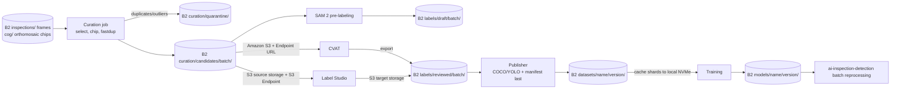

# Label inspection frames and publish versioned defect-detection datasets

## Workload

Defect classes are rare and site-specific: cracks, corrosion, vegetation encroachment, thermal hot spots, broken insulators. Inspection teams relabel and retrain continuously. They need labeling tools that read media from the archive without copying it, and dataset versions that are reproducible and tied to the model versions trained on them.

## Data flow

1. A curation job selects candidate frames from `inspections/` and chips orthomosaic tiles from `cog/`. fastdup flags duplicates, outliers and corrupt files and moves them to `curation/quarantine/`; nothing is deleted. The fastdup Dataset Cleaning sample shows this pattern.
2. SAM 2 writes pre-labeled masks into `labels/draft/<batch>/`. The SAM 2 Mask Dataset Builder sample shows this pattern.
3. Labeling runs in one of two tools:
   - **CVAT** attaches the bucket as cloud storage with provider Amazon S3 and the B2 endpoint in the Endpoint URL field. It reads task data from B2 and exports to B2.
   - **Label Studio** syncs source storage from `curation/candidates/` and writes annotations to target storage in `labels/reviewed/`. Both are configured through its S3 Endpoint field. Media reaches browsers either by presigned URL, which needs bucket CORS, or proxied through Label Studio, which does not.
4. A publisher exports reviewed labels as COCO or YOLO to `datasets/<name>/<version>/`. It writes a `manifest.json` last, listing the source object keys and hashes. Versions are never overwritten.
5. Training workers cache shards on local NVMe, write checkpoints to `models/<name>/<version>/`, and record which dataset version they used.
6. New model versions feed batch reprocessing in [ai-inspection-detection](../ai-inspection-detection/architecture.md).

## B2 zones

| Bucket | Prefix | Versioning / lifecycle | Object Lock | Purpose |
|---|---|---|---|---|
| `<org>-drone-ml` | `curation/candidates/<batch>/` | Expire after labeling closes | None | Frames and chips to label |
| `<org>-drone-ml` | `curation/quarantine/` | Keep for review; expire after N days | None | Duplicates, outliers, corrupt files |
| `<org>-drone-ml` | `labels/draft/`, `labels/reviewed/` | Keep versions while labeling is active | None | Pre-labels and tool exports |
| `<org>-drone-ml` | `datasets/<name>/<version>/` | Immutable; manifest written last | Optional governance retention on release | Training-ready dataset versions |
| `<org>-drone-ml` | `models/<name>/<version>/` | Immutable per version | Optional | Checkpoints and model cards |

## Boundaries

| Stays off B2 | Where | Why |
|---|---|---|
| CVAT and Label Studio databases, queues and caches | Block storage | Transactional application state |
| Experiment-tracking metadata | Tracking server | Queried by run |
| Embedding or vector indexes | Vector database | Low-latency similarity search |
| Training shard cache | Local NVMe | Repeated multi-epoch reads |

## B2 capability map

| Capability | Used | Notes |
|---|---|---|
| S3 API, regional endpoint | Yes | CVAT Endpoint URL, Label Studio S3 Endpoint |
| Presigned GET | Yes | Label Studio browser media; CVAT reads server-side |
| CORS rules | Yes | Exact labeling-tool origin when browsers read presigned URLs |
| Scoped application keys | Yes | Separate source-read, label-write and publisher keys |
| Immutable versioned prefixes with manifests | Yes | B2-side pattern |
| Object Lock | Optional | On released dataset versions |
| Lifecycle rules | Yes | Expire candidates and quarantine ([`examples/lifecycle-ml.json`](../../examples/lifecycle-ml.json)) |
| Overdrive | Consider only if measured | Sustained multi-GPU reads where storage is the bottleneck |
| Event Notifications, CDN, Cloud Replication | Not used | Labeling is human-paced; delivery is internal |

## Integration configuration

### CVAT

Attach cloud storage with **Provider: Amazon S3**, the bucket name, and **Endpoint URL** `https://s3.<region>.backblazeb2.com`. Set the region to the bucket's region. Use a key restricted to `curation/candidates/` with `listFiles,readFiles`. Exports go to `labels/reviewed/` through a separate cloud storage entry with a write-capable key. Follow CVAT's [Backblaze B2 guide](https://docs.cvat.ai/docs/workspace/attach-cloud-storage/#attach-backblaze-b2-storage).

### Label Studio

- **Source storage:** S3 Endpoint `https://s3.<region>.backblazeb2.com`, prefix `curation/candidates/<batch>/`, key with `listFiles,readFiles`.
- **Target storage:** prefix `labels/reviewed/<batch>/`, key with `listFiles,readFiles,writeFiles`. Do not grant `deleteFiles`.
- With presigned URLs on, add a CORS rule for the Label Studio origin with `GET` and `HEAD` (see [`examples/cors-labeling.json`](../../examples/cors-labeling.json)). With them off, Label Studio proxies media and no CORS rule is needed.
- Setup: [Label Studio S3 storage](https://labelstud.io/guide/storage_s3); set the S3 Endpoint field on both source and target storage.

## Security

- One key per role: candidate reader, label writer, publisher, trainer reader. Each is restricted to one bucket and prefix.
- Labeling tools never get `deleteFiles`. Quarantine replaces deletion.
- Treat presigned media URLs as bearer credentials, and restrict CORS to the exact tool origin.
- Restrict who can configure storage endpoints in the labeling tools, because a custom endpoint causes the server to make outbound requests.

## References

- [CVAT: attach cloud storage](https://docs.cvat.ai/docs/workspace/attach-cloud-storage/)
- [Label Studio: Amazon S3 storage](https://labelstud.io/guide/storage_s3)
- [SAM 2](https://github.com/facebookresearch/sam2)
- [fastdup](https://github.com/visual-layer/fastdup)
- [B2 Object Lock](https://www.backblaze.com/docs/cloud-storage-object-lock)
- [B2 Overdrive](https://www.backblaze.com/cloud-storage/b2-overdrive)
- Samples: [SAM 2 Mask Dataset Builder](https://github.com/backblaze-b2-samples/sam2-mask-dataset-builder), [fastdup Dataset Cleaning](https://github.com/backblaze-b2-samples/fastdup-dataset-cleaning)
