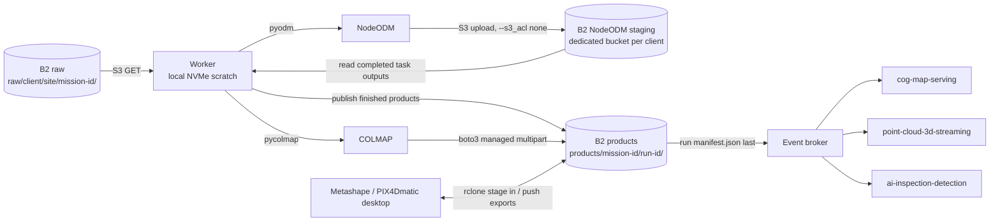

# Reconstruct orthomosaics, elevation models, point clouds and meshes from mission imagery

## Workload

Stateless CPU or GPU workers turn a mission's overlapping images into survey products: an orthomosaic, a DSM/DTM, a LAZ point cloud, a textured mesh and a quality report. The engine is structure-from-motion and multi-view stereo, using OpenDroneMap NodeODM or COLMAP. Size worker scratch space and archived products from the selected output formats and reconstruction settings. Teams reprocess when parameters or software change, so every run's outputs must sit next to its inputs without a shared filesystem.

## Data flow



1. An event (see [flight-capture-offload](../flight-capture-offload/architecture.md)) or an operator triggers a job for `raw/<client>/<site>/<mission-id>/`.
2. The worker downloads images to local NVMe. SfM scratch, feature databases and temporary tiles never go to B2.
3. NodeODM uploads task results to a dedicated private `<org>-drone-nodeodm-<client>` bucket. Give its key access to that bucket without a name prefix: startup writes `test.txt` at the bucket root and results use task-ID paths. Configure `--s3_endpoint`, `--s3_bucket`, `--s3_upload_everything`, and `--s3_acl none`; pass credentials through the environment.
4. The publisher reads completed NodeODM outputs with a separate staging-reader key, or uses local COLMAP results, and uploads them with a products-writer key to `products/<mission-id>/<run-id>/{orthophoto,dsm,dtm,pointcloud,mesh,report}/`.
5. A run `manifest.json`, written last, records software versions, parameters, the input manifest hash and the output keys. A new run id per execution keeps earlier runs immutable.
6. Desktop tools without S3 support, such as Agisoft Metashape and PIX4Dmatic, stay local. rclone stages inputs down and pushes exported products into the same layout.

## B2 zones

| Bucket | Prefix | Versioning / lifecycle | Object Lock | Purpose |
|---|---|---|---|---|
| `<org>-drone-raw` | `raw/<client>/<site>/<mission-id>/` | Read-only here | As in flight-capture-offload | Inputs |
| `<org>-drone-nodeodm-<client>` | `<task-id>/` and root `test.txt` | Expire staging after the publication window ([lifecycle-nodeodm.json](../../examples/lifecycle-nodeodm.json)) | None | Native NodeODM task layout and connection probe |
| `<org>-drone-products` | `products/<mission-id>/<run-id>/` | Immutable per run; optional lifecycle to expire superseded runs | Optional for contractual deliverables | Orthomosaic, DSM/DTM, LAZ, mesh, report, run manifest |
| `<org>-drone-products` | `staging/<job-id>/` | Hide after N days, then delete | None | Desktop-tool exports awaiting review |

Lifecycle rules apply by prefix and age. They cannot keep the last K runs. Expire superseded runs from a job that reads the run manifests, or set lifecycle on a `superseded/` prefix that the job copies into.

## Boundaries

| Stays off B2 | Where | Why |
|---|---|---|
| SfM working directories, feature and match databases, temporary tiles | Local NVMe | Random I/O and in-place edits |
| NodeODM/WebODM task state, job queue | Their own stores | Transactional |
| Pix4Dcloud and DroneDeploy projects | Vendor clouds | No customer-configurable S3 endpoint found; B2 receives exports only |

## B2 capability map

| Capability | Used | Notes |
|---|---|---|
| S3-compatible API, regional endpoint | Yes | NodeODM `--s3_endpoint`, boto3 `endpoint_url` |
| Multipart upload | Yes | Multi-GB GeoTIFF, LAZ and mesh outputs |
| Scoped application keys | Yes | Read the client raw prefix; NodeODM writes its dedicated bucket; the publisher reads staging and writes `products/` |
| Event Notifications | Yes | Run manifest triggers downstream jobs ([`examples/event-notifications-products.json`](../../examples/event-notifications-products.json)) |
| Lifecycle rules | Yes | Expire staging and superseded runs ([`examples/lifecycle-products.json`](../../examples/lifecycle-products.json)) |
| Object Lock | Optional | Contractual deliverables |
| Presigned URLs, CORS | Not here | Delivery is covered in cog-map-serving and point-cloud-3d-streaming |
| Overdrive | Not used | Reconstruction is compute-bound |

## Integration configuration

### OpenDroneMap NodeODM

```bash
# Run with the nodeodm-writer credential for this client
export AWS_ACCESS_KEY_ID="$B2_APPLICATION_KEY_ID"
export AWS_SECRET_ACCESS_KEY="$B2_APPLICATION_KEY"
export AWS_REGION="$B2_REGION"
node index.js \
  --s3_endpoint "s3.${B2_REGION}.backblazeb2.com" \
  --s3_bucket "$ORG-drone-nodeodm-$CLIENT" \
  --s3_upload_everything --s3_acl none
```

- Source: [`config.js`](https://github.com/OpenDroneMap/NodeODM/blob/master/config.js) documents the flags. [`libs/S3.js`](https://github.com/OpenDroneMap/NodeODM/blob/master/libs/S3.js) passes the endpoint to `AWS.Endpoint`. NodeODM also falls back to `AWS_ACCESS_KEY_ID` and `AWS_SECRET_ACCESS_KEY`. Prefer those environment variables over command-line flags, which can show up in process listings.
- Use a dedicated bucket per client or trusted NodeODM deployment. A `products/`-restricted key cannot perform the root connection probe. The publisher uploads completed task outputs into `products/<mission-id>/<run-id>/`, verifies them, and writes the run manifest last. Complete publication before the staging lifecycle expires the task outputs.
- NodeODM's default ACL is `public-read`; always pass `--s3_acl none`.

### COLMAP / pycolmap

COLMAP has no storage layer. The [COLMAP Photogrammetry Archive](https://github.com/backblaze-b2-samples/colmap-photogrammetry-archive) sample stages inputs and archives the database, sparse model and point cloud with boto3 against the B2 endpoint. The B2 connection is the sample's code, not COLMAP's.

### rclone for desktop tools

Use one key restricted to `staging/` with `listFiles,readFiles,writeFiles` and push exports with `rclone copy`. See [flight-capture-offload](../flight-capture-offload/architecture.md#rclone-native-b2-backend).

## Security

- Never leave NodeODM's default `public-read` ACL in place.
- The processing key reads only `raw/<client>/` and cannot delete captures. Keep NodeODM staging credentials separate from the publisher's staging-reader and products-writer credentials.
- Run manifests carry input hashes, so every product traces back to its captures.
- Keep keys in environment variables or a `0600` `.env`, never on the command line or in logs.

## References

- [NodeODM](https://github.com/OpenDroneMap/NodeODM)
- [COLMAP](https://colmap.github.io/)
- [B2 large files and multipart](https://www.backblaze.com/docs/cloud-storage-large-files)
- [B2 lifecycle rules](https://www.backblaze.com/docs/cloud-storage-lifecycle-rules)
- [B2 S3-compatible API](https://www.backblaze.com/docs/cloud-storage-s3-compatible-api)
- Samples: [OpenDroneMap Photogrammetry Pipeline](https://github.com/backblaze-b2-samples/opendronemap-photogrammetry-pipeline), [COLMAP Photogrammetry Archive](https://github.com/backblaze-b2-samples/colmap-photogrammetry-archive), [B2 Event Broker](https://github.com/backblaze-b2-samples/b2-event-broker)
