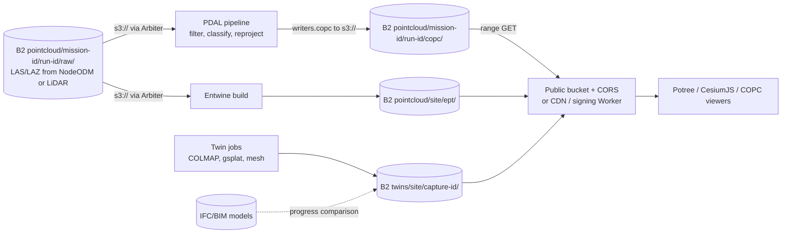

# Convert point clouds and meshes into streamable 3D datasets for web viewers

## Workload

Photogrammetric and drone-LiDAR point clouds run from hundreds of MB to hundreds of GB per site or corridor. Construction, mining and utility clients use them for digital twins, volume measurement and progress tracking, but cannot work with them as downloads. Teams convert them to range-readable formats next to the source data:

- COPC (Cloud Optimized Point Cloud) for single-file streaming.
- EPT (Entwine Point Tile) for very large or multi-flight sites.

Meshes and Gaussian splats are versioned alongside.

## Data flow



1. Source LAS/LAZ from NodeODM ([photogrammetry-processing](../photogrammetry-processing/architecture.md)) or a LiDAR payload lands in `pointcloud/<mission-id>/<run-id>/raw/`.
2. A PDAL pipeline filters, classifies and reprojects the cloud. It reads `s3://` input and writes `.copc.laz` back through Arbiter, with `AWS_ENDPOINT_URL=s3.<region>.backblazeb2.com` (host only; Arbiter prepends `https://`).
3. For multi-flight or very large sites, Entwine builds an EPT index into `pointcloud/<site>/ept/` through the same Arbiter S3 driver.
4. Digital-twin jobs version camera poses, `transforms.json`, meshes and `.ply` splats under `twins/<site>/<capture-id>/`. The COLMAP Gaussian Splatting sample shows this pattern.
5. Viewers such as Potree, CesiumJS and COPC viewers fetch by HTTP URL. They read from a public bucket with CORS, or through a CDN or signing Worker. Per-file presigned URLs are impractical for multi-file octrees.
6. Optionally, the twin is compared against IFC/BIM models to track construction progress. The IfcOpenShell BIM Archive sample shows this pattern.

## B2 zones

| Bucket | Prefix | Versioning / lifecycle | Object Lock | Purpose |
|---|---|---|---|---|
| `<org>-drone-products` | `pointcloud/<mission-id>/<run-id>/raw/` | Immutable per run | Optional | Source LAS/LAZ |
| `<org>-drone-products` | `pointcloud/<mission-id>/<run-id>/copc/` | Immutable per run; expire superseded runs by job | None | COPC for streaming |
| `<org>-drone-products` | `pointcloud/<site>/ept/` | Rebuilt per site version; lifecycle expires old builds under a dated prefix | None | EPT for very large sites |
| `<org>-drone-products` | `twins/<site>/<capture-id>/` | Immutable per capture | None | Poses, meshes, splats, run manifest |
| `<org>-drone-public` (optional) | `tilesets/<dataset-id>/` | Keep current only | None | Cleared datasets served publicly |

## Boundaries

| Stays off B2 | Where | Why |
|---|---|---|
| PostGIS footprints and spatial search indexes | Database | Queried by geometry |
| Viewer session state | Application | Per-user and transient |
| Cesium ion-hosted assets | Cesium ion | Import and export are AWS-only; no B2 endpoint |
| PDAL and Entwine processing scratch | Local disk | Temporary |

## B2 capability map

| Capability | Used | Notes |
|---|---|---|
| S3 API with HTTP range GETs | Yes | COPC and EPT are read by range and by file |
| CORS rules | Yes | Viewer origins, `GET` and `HEAD` |
| Public bucket or CDN origin | Yes | Multi-file tilesets need stable URLs |
| Multipart upload | Yes | Multi-GB COPC and LAZ |
| Scoped application keys | Yes | Processing writes `pointcloud/` and `twins/`; Worker reads only |
| Presigned URLs | Limited | Single-file COPC only; impractical for EPT octrees |
| Event Notifications | Optional | Trigger conversion when a run manifest lands |
| Object Lock, Cloud Replication, Overdrive | Not used | Not required for derived 3D products |

## Integration configuration

### PDAL (via Arbiter)

```bash
export AWS_ENDPOINT_URL="s3.${B2_REGION}.backblazeb2.com"   # host only: Arbiter prepends https://
export AWS_REGION="$B2_REGION"                             # Arbiter otherwise defaults to us-east-1
export AWS_ACCESS_KEY_ID="<application-key-id>" AWS_SECRET_ACCESS_KEY="<application-key>"
pdal translate s3://$BUCKET/pointcloud/$MISSION/$RUN/raw/cloud.laz \
               s3://$BUCKET/pointcloud/$MISSION/$RUN/copc/cloud.copc.laz --writers.copc.forward=all
```

Arbiter's `S3::Config::extractBaseUrl` uses `AWS_ENDPOINT_URL` verbatim as the base URL, or an `endpoint` key from its JSON config. `S3::Resource::url()` then builds `"https://" + base` and `host()` sends the base as the Host header, so the value must be the host without a scheme; `https://s3...` yields `https://https://s3...` and fails signing. Arbiter uses virtual-hosted style unless the bucket name has dots or `AWS_VIRTUAL_HOSTING=FALSE`; B2 accepts either style. See the [vendored source](https://github.com/PDAL/PDAL/blob/master/vendor/arbiter/arbiter.cpp) and [upstream `s3.cpp`](https://github.com/connormanning/arbiter/blob/master/arbiter/drivers/s3.cpp). For writers that only accept local paths in your PDAL build, write to local scratch and upload with rclone or boto3.

### Entwine

Entwine reads and writes `s3://` paths through the same Arbiter driver ([source](https://github.com/connormanning/arbiter/blob/master/arbiter/drivers/s3.cpp)), so configure the same environment variables above.

### Viewers and delivery

Potree, CesiumJS and COPC viewers consume HTTP URLs and have no S3 connector. Choose one delivery path:

- A public bucket with CORS, for cleared datasets.
- A Cloudflare CDN in front of the public bucket.
- The [cloudflare-b2](https://github.com/backblaze-b2-samples/cloudflare-b2) Worker signing requests to a private bucket.

## Security

- Keep source clouds and twins private. Publish only cleared datasets to `<org>-drone-public`.
- Processing uses one key per prefix (`pointcloud/` and `twins/`), since a B2 key carries a single name prefix. The Worker key is read-only.
- CORS lists exact viewer origins (see [`examples/cors-map-viewers.json`](../../examples/cors-map-viewers.json)).
- Site scans can expose security-sensitive infrastructure. Classify them before publishing.

## References

- [PDAL](https://pdal.io)
- [Entwine](https://github.com/connormanning/entwine)
- [COPC specification](https://copc.io)
- [Potree](https://github.com/potree/potree)
- [Backblaze Cloudflare integrations](https://www.backblaze.com/docs/cloud-storage-cloudflare-integrations)
- [B2 CORS rules](https://www.backblaze.com/docs/cloud-storage-cross-origin-resource-sharing-rules)
- Samples: [Open3D Point Cloud Pipeline](https://github.com/backblaze-b2-samples/open3d-point-cloud-pipeline), [COLMAP Gaussian Splatting Pipeline](https://github.com/backblaze-b2-samples/colmap-gaussian-splatting-pipeline), [IfcOpenShell BIM Archive](https://github.com/backblaze-b2-samples/ifcopenshell-bim-archive), [cloudflare-b2](https://github.com/backblaze-b2-samples/cloudflare-b2)
